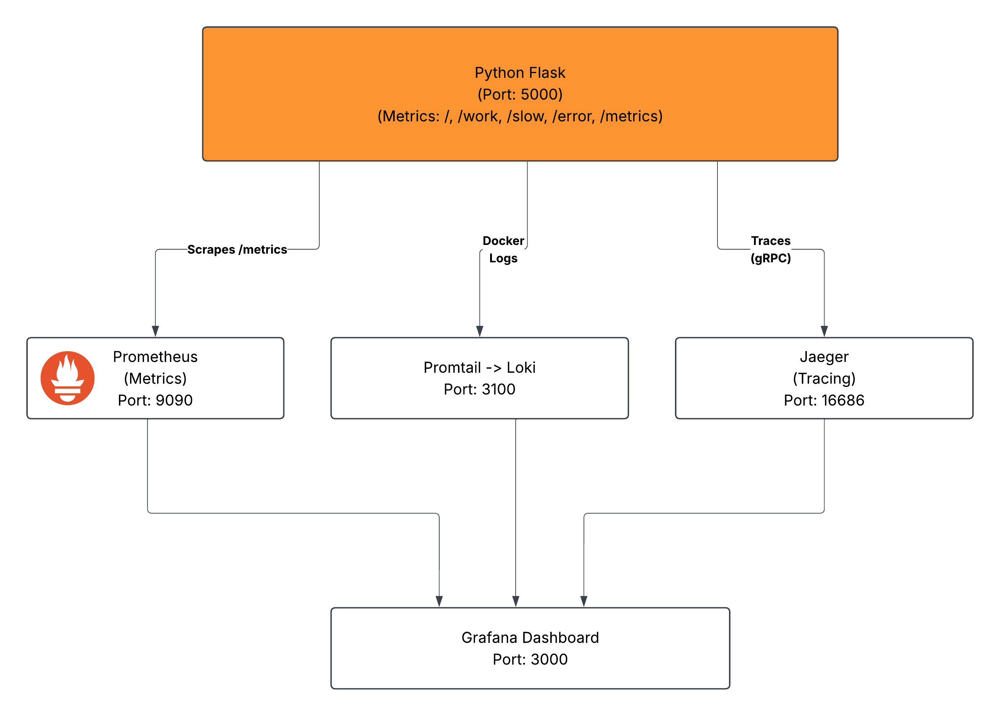
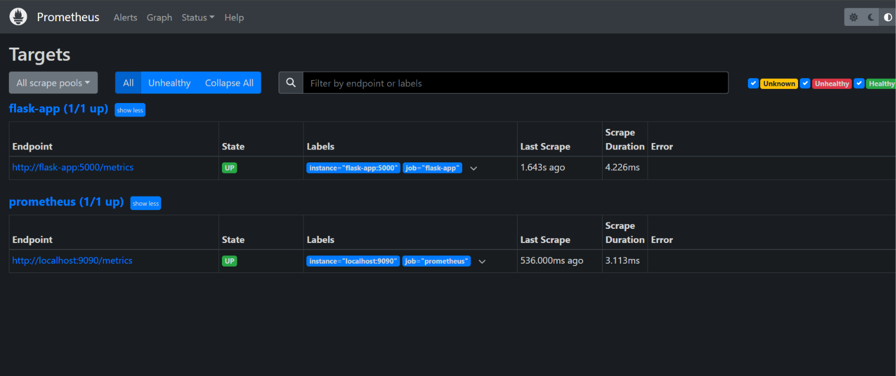
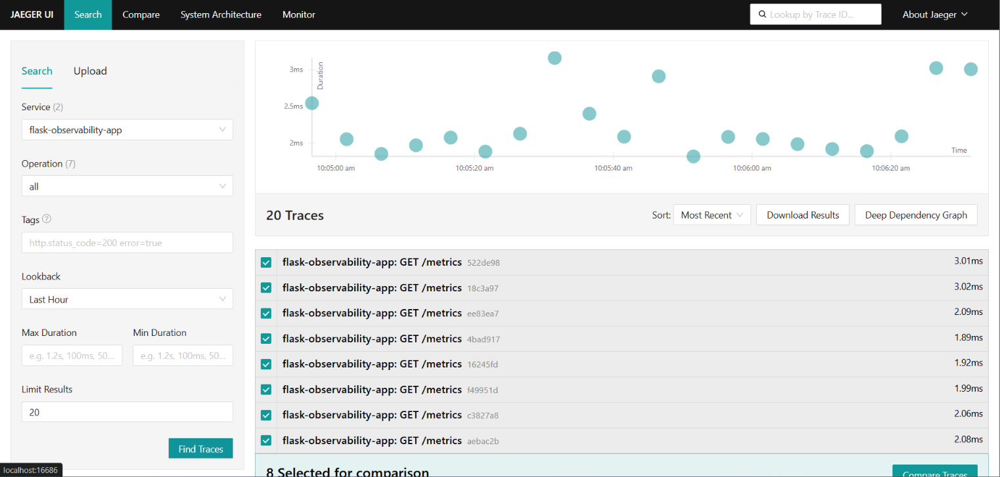
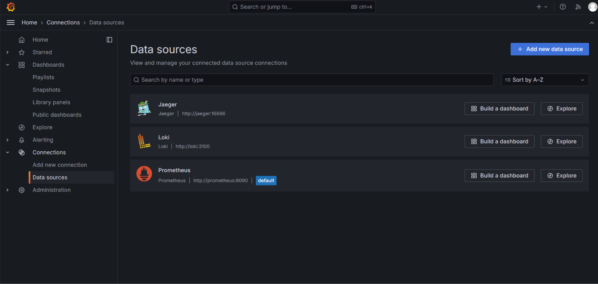
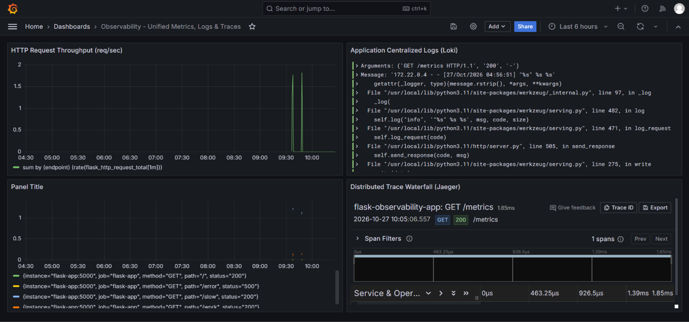

# Complete Observability System (Metrics, Logs & Traces)

[](#)
[](#)
[](#)
[](#)
[](#)

An integrated, cloud-native observability platform combining **Prometheus** time-series metrics, **Grafana Loki & Promtail** centralized logging, and **Jaeger** distributed request tracing into unified **Grafana** visualization dashboards.

Developed as part of the **Elevate Labs DevOps Internship (Ministry of MSME, Govt. of India)**.

---

## Project Overview

Traditional monitoring only reports whether a server is reachable (`UP` or `DOWN`). Modern microservice systems require deep observability to understand _why_ failures occur and where latency spikes originate.

This project implements the **Three Pillars of Observability**:

1. **Metrics:** Polled at 5s intervals by Prometheus to track throughput, error rates, and response latency.
2. **Logs:** Aggregated in real time by Promtail reading Docker container standard output and ingested into Grafana Loki.
3. **Traces:** Distributed spans captured via OpenTelemetry SDK (OTLP over gRPC) and routed to Jaeger to break down single HTTP request lifecycles.

---

## Architecture Diagram

The system orchestrates a Python Flask microservice instrumented to simultaneously expose metrics, ship centralized container logs, and transmit distributed traces.

### System Architecture Diagram



---

## Repository Structure

```text
complete-observability-system/
├── app/
│   ├── app.py                            # Flask application instrumented with OpenTelemetry & Prometheus
│   ├── Dockerfile                        # Multi-stage/Slim Python runtime container definition
│   └── requirements.txt                  # Application & telemetry SDK dependencies
├── docs/
├── architecture/                     # System architecture diagrams and specifications
│   │   └── observability-architecture.png # Complete observability architectural design
│   └── screenshots/                      # Project verification proof & dashboard evidence
│       ├── 1-prometheus-targets.png      # Prometheus scrape targets showing UP state
│       ├── 2-jaeger-traces.png           # Jaeger UI showing captured distributed traces
│       ├── 3-grafana-datasources.png     # Grafana provisioned datasources (Prometheus, Loki, Jaeger)
│       └── 4-grafana-unified-dashboard.png # Unified Grafana dashboard with metrics, logs & traces
├── grafana/
│   └── provisioning/
│       ├── dashboards/
│       │   └── dashboard.json            # Exported unified dashboard model
│       └── datasources/
│           └── datasources.yml           # Automated datasource provisioning definitions
├── loki/
│   └── loki-config.yml                   # TSDB filesystem schema & storage configuration
├── prometheus/
│   └── prometheus.yml                    # Prometheus scrape configurations & polling intervals
├── promtail/
│   └── promtail-config.yml               # Container log discovery via Docker daemon socket
├── docker-compose.yml                    # Multi-container orchestration stack
└── README.md                             # Project documentation & run guide
```

---

## Quickstart & Execution

### 1. Prerequisites

- Docker Engine (v24.0+) & Docker Compose (v2.20+)
- Linux / WSL2 environment

### 2. Start the Observability Stack

Launch all 6 services with a single command:

```bash
docker compose up -d --build
```

### 3. Verify Container Status

Check that all containers are running and healthy:

```bash
docker compose ps
```

_Expected output:_

```text
NAME                      SERVICE      STATUS         PORTS
flask-observability-app   flask-app    Up             0.0.0.0:5000->5000/tcp
grafana                   grafana      Up             0.0.0.0:3000->3000/tcp
jaeger                    jaeger       Up             0.0.0.0:4317->4317/tcp, 0.0.0.0:16686->16686/tcp
loki                      loki         Up             0.0.0.0:3100->3100/tcp
prometheus                prometheus   Up             0.0.0.0:9090->9090/tcp
promtail                  promtail     Up
```

---

## Telemetry & Synthetic Traffic Generation

Generate requests to populate metrics, trigger distributed traces, and write application logs:

```bash
for i in {1..40}; do
  curl -s http://localhost:5000/ > /dev/null
  curl -s http://localhost:5000/work > /dev/null
  curl -s http://localhost:5000/slow > /dev/null
  curl -s http://localhost:5000/error > /dev/null
  sleep 0.2
done
```

### Endpoints Overview

| Endpoint   | Method | Purpose                    | Telemetry Emitted                                             |
| :--------- | :----- | :------------------------- | :------------------------------------------------------------ |
| `/`        | `GET`  | Service index & health     | HTTP 200, Info log                                            |
| `/work`    | `GET`  | Simulated computation      | Latency (50–250ms), span `compute_job`                        |
| `/slow`    | `GET`  | Simulated database latency | Latency (800–1500ms), span `slow_database_query`, warning log |
| `/error`   | `GET`  | Failure simulation         | HTTP 500 error metric, error log                              |
| `/metrics` | `GET`  | Prometheus telemetry pull  | Prometheus raw counter and histogram exposition               |

---

## Accessing Observability Portals

| Tool           | URL                      | Default Credentials | Description                                        |
| :------------- | :----------------------- | :------------------ | :------------------------------------------------- |
| **Flask App**  | `http://localhost:5000`  | None                | Application API endpoints                          |
| **Prometheus** | `http://localhost:9090`  | None                | Target status and PromQL query console             |
| **Jaeger UI**  | `http://localhost:16686` | None                | Distributed trace search & span waterfall timeline |
| **Grafana**    | `http://localhost:3000`  | `admin` / `admin`   | Unified monitoring & correlation UI                |

---

## 🔍 Grafana Telemetry Queries

### 1. Prometheus (PromQL)

- **Request Throughput by Endpoint:**

  ```promql
  sum by (endpoint) (rate(flask_http_request_total[1m]))
  ```

- **Average Request Latency:**

  ```promql
  rate(flask_http_request_duration_seconds_sum[1m]) / rate(flask_http_request_duration_seconds_count[1m])
  ```

### 2. Loki (LogQL)

- **Stream Application Logs:**

  ```logql
  {container="flask-observability-app"}
  ```

- **Filter Runtime Errors:**

  ```logql
  {container="flask-observability-app"} |= "ERROR"
  ```

### 3. Jaeger Tracing

- **Service:** `flask-observability-app`
- Inspect waterfall breakdowns for individual operations: `slow_database_query`, `compute_job`, and `GET /metrics`.

---

## 📸 Verification & Screenshots

|                    Prometheus Scraping Active                    |           Jaeger Distributed Trace Waterfall           |
| :--------------------------------------------------------------: | :----------------------------------------------------: |
|  |  |

|                Grafana Pre-Provisioned Datasources                 |                       Unified Grafana Dashboard                        |
| :----------------------------------------------------------------: | :--------------------------------------------------------------------: |
|  |  |

---

## DevOps & SRE Interview Q&A

### 1. What are the three pillars of observability?

- **Metrics:** Numeric values measured over time intervals (counters, gauges, histograms) optimal for alerting and trend detection.
- **Logs:** Timestamped discrete event messages containing context and stack traces.
- **Traces:** Request lifecycle representations across distributed microservices, identifying downstream latency bottlenecks.

### 2. What is the difference between monitoring and observability?

- **Monitoring** tells you _when_ a system is failing by tracking predefined dashboards, thresholds, and health checks (answers: "Is it working?").
- **Observability** is a measure of how well you can infer the internal states of a system based on external outputs (answers: "Why is it broken?" and helps debug unknown unknowns).

### 3. How does Prometheus scrape metrics?

Prometheus utilizes a **pull-based** model. It periodically queries configured HTTP endpoints (`/metrics`) exposed by target services, decodes text-format metrics, and records them in its local time-series database (TSDB).

### 4. How does Grafana Loki differ from the ELK (Elasticsearch, Logstash, Kibana) stack?

Loki indexes only the metadata/labels of logs rather than full-text indexing the message bodies. This reduces indexing storage overhead, CPU usage, and memory consumption compared to Elasticsearch while allowing seamless integration with Prometheus label schemas.

### 5. What is distributed request tracing and why is it essential?

Distributed request tracing propagates unique trace context (Trace ID, Span ID) across network boundaries. It enables engineers to trace a request through multiple services, queues, and databases, identifying the exact component responsible for latency spikes or unhandled exceptions.

---

## License

This project is open-source under the MIT License.
