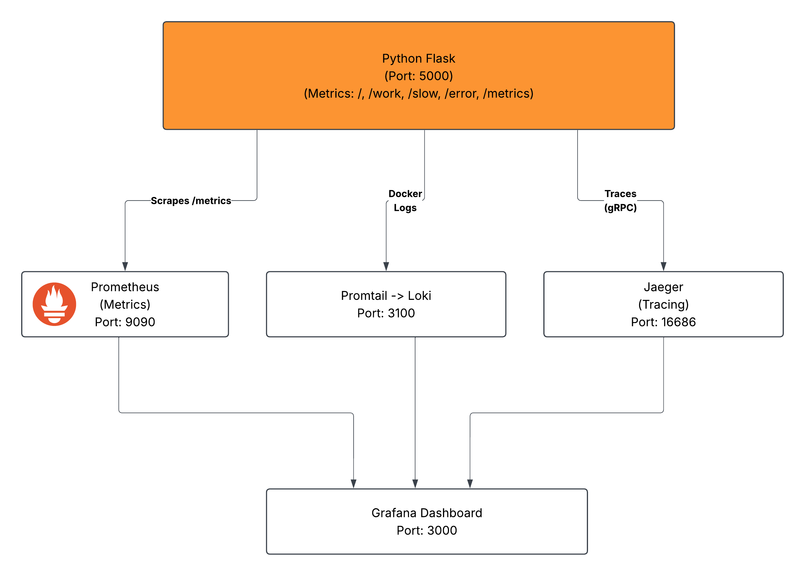

# Project Report: Complete Observability System (Metrics, Logs & Traces)

**Author:** Preetham Pereira (`cloudwithpreetham`)  
**Program:** Elevate Labs DevOps Internship — Ministry of MSME, Govt. of India  
**Project Selection:** Project #3 — Complete Observability System  
**Deliverable File:** [`docs/PROJECT_REPORT.pdf`](PROJECT_REPORT.pdf) (4-Page Executive Engineering Report PDF)

---

## 1. Executive Summary & Problem Statement

Modern cloud-native architectures rely on microservices that communicate asynchronously across distributed networks. Traditional infrastructure monitoring answers only whether a host or service is reachable (*"Is it up?"*), leaving engineering teams blind when diagnosing tail latency, intermittent errors, and cascading bottlenecks.

This project delivers a self-contained, single-command Observability Minimum Viable Product (`docker compose up -d --build`) built around an instrumented Python Flask microservice (`flask-observability-app`). By integrating **Prometheus v2.52.0**, **Grafana Loki v3.0.0**, **Promtail v3.0.0**, **Jaeger v1.57**, **OpenTelemetry SDK 1.25.0**, and **Grafana v10.4.2**, the platform unifies all **Three Pillars of Observability** (Metrics, Logs, and Distributed Traces) inside pre-provisioned Grafana dashboards with zero manual UI setup.

---

## 2. Containerized Stack & Service Topology

| Service / Container | Image / Runtime | Host Port(s) | Configuration / Mount | Architectural Role |
| :--- | :--- | :--- | :--- | :--- |
| **`flask-app`** (`flask-observability-app`) | `./app` (`python:3.11-slim`) | `5000:5000` | `OTEL_PYTHON_LOG_CORRELATION=true` | Simulated microservice exposing workloads, `/metrics`, OTLP traces, and trace-annotated stdout logs. |
| **`prometheus`** | `prom/prometheus:v2.52.0` | `9090:9090` | `prometheus/prometheus.yml` | Pull-based TSDB scraping `flask-app:5000/metrics` and `localhost:9090` every 5s. |
| **`loki`** | `grafana/loki:3.0.0` | `3100:3100` | `loki/loki-config.yml` | Centralized log aggregator using v13 TSDB filesystem chunks and 24h index periods. |
| **`promtail`** | `grafana/promtail:3.0.0` | Internal `9080` | `promtail/promtail-config.yml`, `/var/run/docker.sock:ro` | Docker service discovery log shipper extracting `container` labels and pushing logs to Loki. |
| **`jaeger`** | `jaegertracing/all-in-one:1.57` | `16686:16686`, `4317:4317` | `COLLECTOR_OTLP_ENABLED=true` | OTLP gRPC trace collector, backend store, and waterfall visualizer. |
| **`grafana`** | `grafana/grafana:10.4.2` | `3000:3000` | `grafana/provisioning/` | Unified dashboard UI auto-provisioning Prometheus, Loki, and Jaeger datasources and 4-panel dashboard. |

---

## 3. System Architecture & Telemetry Pipelines

1. **Metrics Pull Pipeline:** Prometheus scrapes `/metrics` every 5 seconds via internal Docker DNS (`flask-app:5000`), recording request counters (`flask_http_request_total`), status codes, latency histograms (`flask_http_request_duration_seconds_*`), and `app_info`.
2. **Decoupled Log Shipping:** Flask writes unbuffered logs (`PYTHONUNBUFFERED=1`) to stdout. Promtail mounts the Docker socket read-only, strips container name prefixes into the `container` label, and pushes streams to `http://loki:3100/loki/api/v1/push`.
3. **OTLP Distributed Tracing:** `TracerProvider` tags spans with `service.name="flask-observability-app"` and exports via `BatchSpanProcessor` + `OTLPSpanExporter` (`jaeger:4317`, plaintext gRPC).

---

## 4. Microservice Instrumentation & Endpoints (`app/app.py`)

| Endpoint | HTTP Status | Simulated Workload / Latency | OpenTelemetry Span | Telemetry Emitted |
| :--- | :---: | :--- | :--- | :--- |
| `GET /` | `200 OK` | Service index & endpoint list | Auto HTTP root span | `INFO` log + request counter |
| `GET /work` | `200 OK` | Batch compute (`50–250 ms`) | Child span `compute_job` | `INFO` latency log + duration histogram |
| `GET /slow` | `200 OK` | Slow DB query (`800–1500 ms`) | Child span `slow_database_query` | `WARNING` alert log + tail latency spike |
| `GET /error` | `500 ERR` | Simulated server failure | Auto HTTP span (`status=500`) | `ERROR` log + HTTP 500 error counter |
| `GET /metrics` | `200 OK` | Prometheus exposition pull | Auto HTTP span (scraped /5s) | Counters, histograms & `app_info` |

A custom `logging.setLogRecordFactory(record_factory)` hook wraps Python log records to inject the active 32-character hexadecimal `otelTraceID` and 16-character `otelSpanID` (with zero-padded fallbacks when outside an active span), preventing `KeyError` crashes from background loggers (e.g., Werkzeug) and guaranteeing clean Trace-to-Log correlation.

---

## 5. Declarative Grafana Provisioning & Telemetry Queries

`grafana/provisioning/datasources/datasources.yml` registers deterministic datasource UIDs (`prometheus`, `loki`, `jaeger`), and `dashboards.yml` loads `dashboard.json` (UID `eg2gkti31bls0b`) with four panels:

- **HTTP Request Throughput (PromQL):** `sum by (endpoint) (rate(flask_http_request_total[1m]))`
- **Average Request Latency (PromQL):** `rate(flask_http_request_duration_seconds_sum[1m]) / rate(flask_http_request_duration_seconds_count[1m])`
- **Centralized Application Logs (LogQL):** `{container="flask-observability-app"}`
- **Distributed Trace Waterfall (Jaeger):** `service: "flask-observability-app"` (`limit: 20`)

---

## 6. Verification Results & Production Hardening Recommendations

### Verified Runtime Evidence (`docs/screenshots/`)

- **Container Orchestration (`6-docker-compose-ps.png`):** All 6 containers (`flask-observability-app`, `grafana`, `jaeger`, `loki`, `prometheus`, `promtail`) active with bound host ports.
- **Prometheus Targets (`1-prometheus-targets.png`):** Both `flask-app` (`4.226 ms` scrape) and `prometheus` (`3.113 ms` scrape) report `UP`.
- **Grafana Datasources (`3-grafana-datasources.png`):** Jaeger, Loki, and Prometheus (default) automatically wired.
- **Jaeger Traces (`2-jaeger-traces.png`):** `flask-observability-app` reports 7 operations and 20 captured traces.
- **Loki Exploration (`5-loki-log-exploration.png`):** Captured synthetic test traffic volume: `info: 761`, `error: 40`, `warning: 21` (`822` lines, `105 kB` processed).
- **Unified Dashboard (`4-grafana-unified-dashboard.png`):** Correlates throughput, latency, logs, and Jaeger span waterfalls in a single view.

### Production Hardening Roadmap (Codebase Audit)

1. **Persistent Storage Volumes:** Add named Docker volumes for `/prometheus`, `/loki`, and `/var/lib/grafana` so historical telemetry persists across container restarts.
2. **Security Posture:** Disable `GF_AUTH_ANONYMOUS_ENABLED=true`, rotate default `admin/admin` credentials, enable TLS for OTLP gRPC (`jaeger:4317`), and replace Promtail's host `docker.sock` mount with a scoped logging driver or socket proxy.
3. **Production WSGI & Scrape Trace Filtering:** Run Flask behind Gunicorn instead of Werkzeug's dev server, and pass `excluded_urls="/metrics"` to `FlaskInstrumentor` so 5s Prometheus scrapes do not clutter Jaeger traces.
4. **Healthchecks & Alerting:** Add explicit Docker `healthcheck` probes in `docker-compose.yml` and configure Prometheus/Grafana alerts for 5xx error spikes and p95 latency SLOs.
